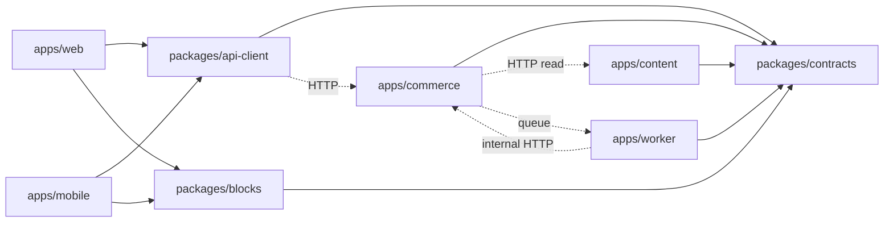
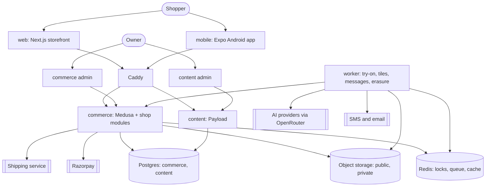
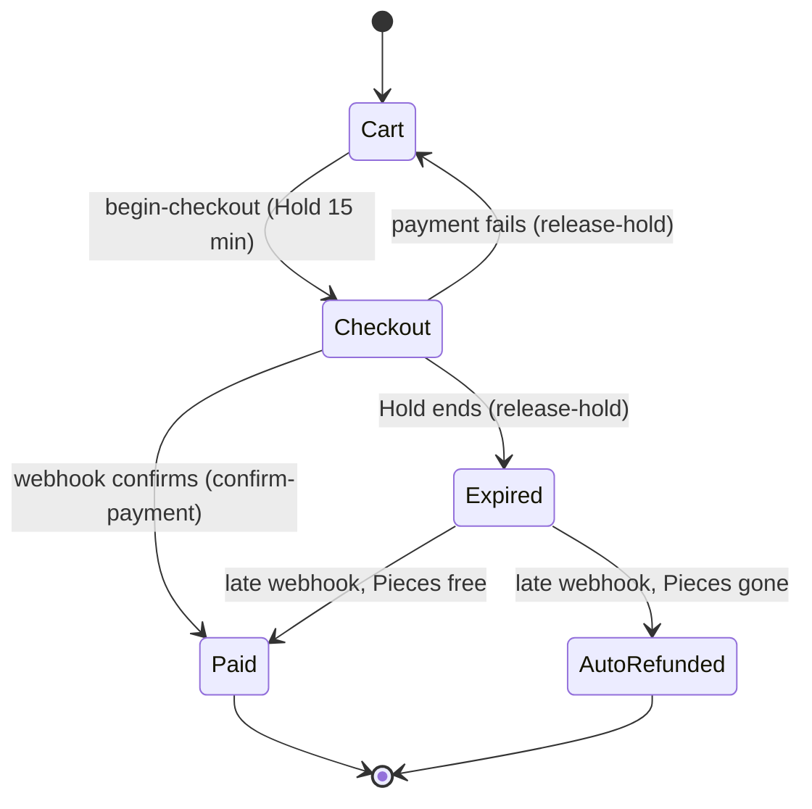
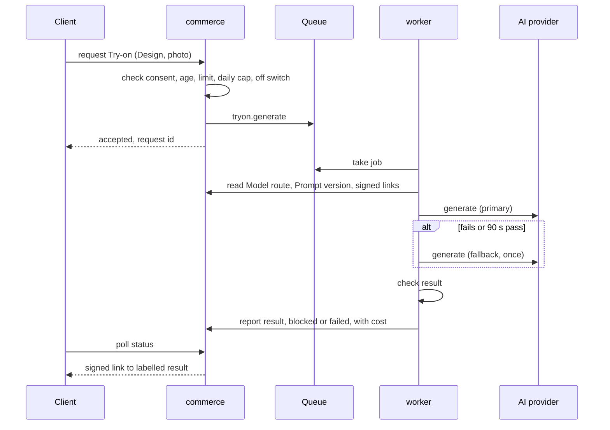
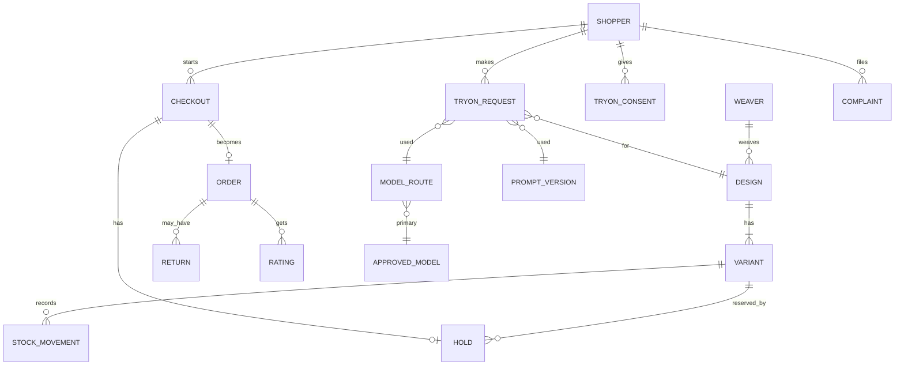

# Architecture Spine — Alar

Items tagged `[ADOPTED]` were decided by the founder. Items tagged `[ASSUMPTION]` were decided here on the fast path and are open to correction. Terms follow the PRD Glossary.

## Design Paradigm

**A modular monolith on a commerce kernel, with ports and adapters at every external edge.**

- **Kernel:** the commerce application. It owns all business state and every state change.
- **Modules:** self-contained units inside the kernel (try-on, consent, weaver, hold, settings, audit and others). Modules do not call each other; workflows compose them.
- **Ports and adapters:** every outside service (payment, shipping, AI provider, messaging, object storage) is reached through an interface defined inside the kernel or worker, with one adapter per vendor.
- **Sidecars:** the content application (screens and documents) and the worker (slow jobs). Neither owns business state.
- **Clients:** website and Android app. They hold no business rules.

| Layer | Directory |
| --- | --- |
| Kernel and modules | `apps/commerce/src/modules/*`, `apps/commerce/src/workflows/*` |
| Kernel API | `apps/commerce/src/api/*` |
| Adapters | `apps/commerce/src/providers/*`, `apps/worker/src/providers/*` |
| Content sidecar | `apps/content` |
| Worker sidecar | `apps/worker` |
| Clients | `apps/web`, `apps/mobile` |
| Shared contracts | `packages/contracts`, `packages/api-client`, `packages/blocks` |

## Invariants & Rules



Solid arrows are code imports; dotted arrows are runtime calls. No arrow means no dependency is allowed.

### AD-1 — One writer of business state `[ADOPTED: not microservices]`

- **Binds:** all
- **Prevents:** two units changing an Order, stock, consent or try-on record by different paths.
- **Rule:** only `apps/commerce` writes business state. `apps/worker` and `apps/content` never connect to the commerce database. The worker changes state only by calling the internal API in AD-9.

### AD-2 — Clients reach the backend through one package

- **Binds:** `apps/web`, `apps/mobile`, FR-1..FR-33
- **Prevents:** screens coupling to two backends or two response shapes; a swap of commerce or content system reaching into UI code.
- **Rule:** UI code imports data only from `packages/api-client`. That package calls the commerce application only: its standard store API for catalogue, cart and checkout, and `/store/shop/*` routes for everything specific to this shop. Clients never call `apps/content` or any third party directly, except the payment service's own checkout component.

### AD-3 — Data ownership by unit

- **Binds:** all persistence
- **Prevents:** two owners of one entity; joins across units.
- **Rule:** one Postgres server, two databases: `commerce` (owned by `apps/commerce`) and `content` (owned by `apps/content`). No unit reads another unit's database. Content refers to a Design or Weaver only by its commerce id. Commerce refers to content only by document id and version.

| Entity | Owner |
| --- | --- |
| Design, Variant, stock, Hold, cart, Checkout, Order, Return, refund, invoice, discount, Shopper | commerce kernel |
| Weaver, Try-on consent, Try-on request and result, Model route, Approved-model list, Prompt version, limits, shop settings, rating, complaint, audit event, stock movement | commerce modules |
| Screens and Blocks, Try-on consent notice text, terms, policies, disclosures, translations | content |
| Shopper photo and Try-on result files, product photos, saree tiles | object storage, referenced by commerce records |

### AD-4 — Every state change is a workflow

- **Binds:** `apps/commerce`
- **Prevents:** business rules scattered across route handlers, jobs and admin screens, each handling failure differently.
- **Rule:** a change to business state runs as a named workflow with compensation steps. API routes, admin actions, scheduled jobs and webhook handlers only validate input and start a workflow. A module's service is called only from a workflow step, never from another module.

### AD-5 — Money is integer paise; shelf prices are whole rupees

- **Binds:** FR-5, FR-20, FR-37, FR-58
- **Prevents:** floating-point totals, and two units rounding differently.
- **Rule:** amounts are integers in paise in storage, APIs, events and jobs. A shelf price is tax-inclusive and a multiple of 100 paise. Tax is derived backwards from the shelf price; any rounding remainder goes into the tax line. All arithmetic uses the money functions in `packages/contracts`. Clients format amounts; they never compute them.

### AD-6 — Stock changes only through five workflows

- **Binds:** FR-16, FR-19, FR-25, FR-36
- **Prevents:** overselling; a stock count nobody can explain.
- **Rule:** available = stocked − reserved. A Hold is an inventory reservation with an expiry, created by `begin-checkout` under a lock on each inventory item, using the Redis lock provider. Only these workflows change stocked or reserved quantities: `begin-checkout`, `confirm-payment`, `release-hold`, `adjust-stock`, `restock-return`. Each writes one stock-movement row per change. A scheduled job runs `release-hold` for expired Holds.

### AD-7 — The payment service's webhook is the only payment truth

- **Binds:** FR-18, FR-19, FR-24, FR-48, NFR-4
- **Prevents:** an Order created from a client's word; double Orders; lost payments.
- **Rule:** a payment is confirmed only by a signature-verified webhook, handled by `confirm-payment`. The client's return from the payment screen only asks the server for status. Handlers are idempotent on the payment service's payment id. A confirmation arriving after its Hold expired follows FR-19. A daily job reconciles payments against Orders and alerts on any difference.

### AD-8 — One queue; jobs are idempotent

- **Binds:** `apps/commerce`, `apps/worker`, FR-7, FR-11, FR-15, FR-51, FR-54
- **Prevents:** two job systems; duplicate side effects on retry.
- **Rule:** slow work runs as BullMQ jobs on Redis. Only commerce enqueues; only the worker consumes. Job names and payloads are defined in `packages/contracts`. Every job carries an id and is safe to run twice. Messages to Shoppers (FR-54) are jobs, started by workflows.

### AD-9 — The worker reports back through an internal API

- **Binds:** `apps/worker`, `apps/commerce`
- **Prevents:** the worker becoming a second writer.
- **Rule:** the worker calls `/internal/*` on commerce with a service token to report progress and results. `/internal/*` is not reachable from outside the private network.

### AD-10 — AI providers sit behind one port

- **Binds:** FR-11, FR-39..FR-43, FR-52
- **Prevents:** provider-specific code leaking into workflows; an admin edit weakening a guardrail.
- **Rule:** the worker calls AI providers only through the `TryOnProvider` interface (`generate`, returning result, blocked or failed) and the `ResultCheck` interface. The Model route, model settings and Prompt version are read from the try-on module when the job starts. The fixed safety wording, the no-retention and no-logging request flags, and the output check are in worker code and are not data. Each request records provider, model, Prompt version and cost.

### AD-11 — Shopper photos are private, short-lived and erased one way `[ADOPTED: consent, adults only]`

- **Binds:** FR-8..FR-15, FR-27, FR-51, NFR-5, NFR-6
- **Prevents:** a photo leaking through a URL or log; an erasure path that misses a copy.
- **Rule:** Shopper photos and Try-on results live in a private bucket. They are read only through signed links valid for at most 10 minutes, issued by commerce. No photo, link or image bytes appear in logs or job results. One workflow, `erase-shopper-media`, deletes files, records and provider copies; withdrawal, the retention job and account deletion all call it. No Try-on job starts without a current Try-on consent whose notice names the receiving AI service.

### AD-12 — Server-driven screens are versioned data

- **Binds:** FR-30..FR-33, FR-55
- **Prevents:** web and mobile rendering the same screen differently; an old app crashing; screen data switching on unreviewed features.
- **Rule:** a screen is a `ScreenV1` document defined in `packages/contracts`. Commerce reads Blocks from content and returns `ScreenV1`; clients never see content's own shape. `packages/blocks` maps each Block type to its properties; each client supplies a component per type. An unknown Block type is skipped. Within `ScreenV1` changes are additive only. A Block carries data and a named action from a fixed list; it never carries code or expressions. A client that cannot fetch a screen shows its last copy.

### AD-13 — Regulated values are data with dates

- **Binds:** FR-37, FR-56, FR-59, PRD §8
- **Prevents:** a legal or tax answer changing code.
- **Rule:** tax rates per tax code, return period, delivery region, shipping charge rule, Try-on limits, retention period and Hold length are settings with an effective date. Notices and policies are numbered versions in content. Code reads them; it never hardcodes them.

### AD-14 — Every admin change is audited

- **Binds:** FR-36, FR-46, FR-56, FR-60
- **Prevents:** changes nobody can trace; redesign when staff accounts arrive.
- **Rule:** every workflow started from the admin writes an audit event: actor account, time, action, before and after. Audit events are append-only; no route updates or deletes them.

### AD-15 — Three kinds of identity, never mixed

- **Binds:** FR-26, FR-60, AD-9
- **Prevents:** a Shopper token opening the admin; a service acting as a person.
- **Rule:** Shoppers sign in through the commerce system's customer auth with a one-time-code provider. Admin accounts use password plus second factor. Services use service tokens. Each route accepts exactly one kind.

### AD-16 — Portable by construction `[ADOPTED: free tier first, movable later]`

- **Binds:** deployment, NFR-8
- **Prevents:** lock-in to one cloud; a move that needs a rewrite.
- **Rule:** every unit runs as a container started from one compose file. The only outside contracts are Postgres, Redis, the S3 interface, HTTP to vendors and email. No cloud vendor's SDK is used except an S3 client. All configuration comes from environment variables. The same compose file runs locally against the local AWS emulator.

### AD-17 — Recovery is continuous, off the server

- **Binds:** NFR-4, NFR-8
- **Prevents:** a lost server losing paid Orders or photos of the catalogue.
- **Rule:** Postgres ships its write-ahead log continuously, and a full backup nightly, to object storage in a different location from the server. Buckets holding product photos, saree tiles and invoices keep versions. A restore script rebuilds the whole system on a clean server and is run before launch and each quarter.

### AD-18 — Full saree view is tiles in a web viewer

- **Binds:** FR-6, FR-7
- **Prevents:** two viewers behaving differently on web and phone.
- **Rule:** the worker cuts each full-length image into a Deep Zoom tile pyramid and stores it in the public bucket. Web and mobile show it with the same OpenSeadragon page; on mobile that page runs in a web view inside a native screen.

### AD-19 — One language, one schema source

- **Binds:** all code
- **Prevents:** hand-copied types drifting between server, web and app.
- **Rule:** all units are TypeScript. Every shape that crosses a unit boundary (API request and response, `ScreenV1`, job payload, event) is a zod schema in `packages/contracts`, and types are inferred from it. No unit redefines such a shape.

### AD-20 — The product name is configuration

- **Binds:** NFR-12
- **Prevents:** a rename touching code or app-store identity.
- **Rule:** the name appears only in settings and content. Package scope is `@shop/*`. Bundle and application ids, bucket names, database names and domains in code do not contain it.

## Consistency Conventions

| Concern | Convention |
| --- | --- |
| Naming | Files and directories kebab-case; types PascalCase; database tables and columns snake_case; workflows verb-noun (`begin-checkout`); events `noun.past-verb` (`order.paid`); jobs `noun.verb` (`tryon.generate`). |
| Ids and time | Ids are the commerce system's prefixed ids. Times are UTC ISO 8601 in storage and APIs; clients display India time. |
| Errors | Every API error is `{ code, message, details? }` with a stable `code` from `packages/contracts`. Clients branch on `code`, never on `message`. |
| Idempotency | Every client request that changes state sends an `Idempotency-Key`. Webhooks and jobs are idempotent on the sender's id. |
| Logging | Structured JSON with a request id passed from client to commerce to worker to vendor. No personal data, photos, links, tokens or card data in logs. |
| Config and secrets | Environment variables only, validated at start by a zod schema. Secrets never in the repository. |
| Vendors | A vendor is used only through an adapter in a `providers/` directory. Each adapter has contract tests against the vendor's test environment (NFR-11). |
| Text | No Shopper-facing text in code; all of it comes from content or a translation file (NFR-14). |
| Testing | Each workflow has tests for success, each failure and compensation. One end-to-end test buys, ships and returns a saree. All must pass before a deploy. |

## Stack

Versions verified on the package registry on 2026-11-27.

| Name | Version |
| --- | --- |
| Node.js | 22 LTS (22.23.5 or later) |
| TypeScript | 5.x |
| Medusa (`@medusajs/medusa`) | 2.23.1 |
| Payload (`payload`, `@payloadcms/next`, `@payloadcms/db-postgres`, `@payloadcms/storage-s3`) | 3.94.2 |
| Next.js, content app | 16.4.6 |
| Next.js, web storefront (Medusa starter) | 15.3.9 |
| Expo | 58.1.0 |
| React Native | 0.88.1 |
| expo-router | 58.0.33 |
| react-native-webview | 14.0.1 |
| PostgreSQL | 17 |
| Redis | 7 |
| BullMQ | 6.7.10 |
| zod | 4.6.7 |
| sharp (libvips) | 0.35.5 |
| OpenSeadragon | 6.1.1 |
| Razorpay Node SDK | 2.9.8 |
| Caddy (reverse proxy, TLS) | 2 |
| Docker Compose | v2 |
| Floci (local AWS emulator) | latest |

## Structural Seed

### Containers



### Checkout and Hold



### Try-on



### Core entities



### Repository

```text
/
  apps/
    commerce/        # Medusa app
      src/modules/   # tryon, consent, weaver, settings, rating, complaint, audit, stock-ledger
      src/workflows/ # begin-checkout, confirm-payment, release-hold, adjust-stock, restock-return, erase-shopper-media, ...
      src/providers/ # razorpay (payment), shipping, one-time-code (auth), messaging
      src/api/       # store/shop/*, admin/shop/*, internal/*, hooks/*
      src/admin/     # admin extensions: AI controls, weavers, settings, review queue, complaints
      src/jobs/      # scheduled: expired Holds, retention, reconciliation
    content/         # Payload app: screens, blocks, notices, policies, translations
    worker/          # BullMQ consumers
      src/jobs/      # tryon.generate, tiles.build, message.send, media.erase
      src/providers/ # TryOnProvider adapters (openrouter first), ResultCheck, sms, email
    web/             # Next.js storefront from the Medusa starter
    mobile/          # Expo app
  packages/
    contracts/       # zod schemas, error codes, money functions, job and event names
    api-client/      # the only way clients talk to the backend
    blocks/          # Block types and properties shared by web and mobile
  infra/             # compose files, Caddy config, backup and restore scripts
  docs/
```

### Deployment and environments

| Environment | Where | Notes |
| --- | --- | --- |
| Local | Developer machine, compose | Floci for object storage; vendor test modes |
| Staging | Oracle Cloud free ARM server, compose | Vendor test modes; restore rehearsals run here |
| Production | Same kind of server at first `[ADOPTED]`; movable under AD-16 | Vendor live modes; backups to object storage in another location |

Deploys are built in continuous integration as ARM64 images and rolled out by replacing containers; database migrations run before the new containers start.

## Capability → Architecture Map

| Capability | Lives in | Governed by |
| --- | --- | --- |
| Catalogue, search, Design page (FR-1..FR-5) | commerce kernel, weaver module; `apps/web`, `apps/mobile` | AD-2, AD-3, AD-5 |
| Full saree view (FR-6, FR-7) | worker `tiles.build`; viewer page | AD-8, AD-18 |
| Try-on (FR-8..FR-15, FR-51, FR-52) | tryon and consent modules; worker `tryon.generate` | AD-8..AD-11 |
| Cart, checkout, payment (FR-16..FR-20) | commerce kernel; razorpay provider; hold workflows | AD-4..AD-7 |
| Orders, shipping, Returns, rating (FR-21..FR-25, FR-53) | commerce kernel; shipping provider; rating module | AD-4, AD-6 |
| Accounts, privacy, messages (FR-26..FR-29, FR-54) | commerce auth with one-time-code provider; complaint module; worker `message.send` | AD-8, AD-11, AD-15 |
| Server-driven screens (FR-30..FR-33, FR-55) | content; commerce `/store/shop/screens`; `packages/blocks` | AD-12 |
| Admin: catalogue, stock, settings, weavers, discounts, notices (FR-34..FR-38, FR-56..FR-59) | commerce admin and extensions; content admin | AD-3, AD-5, AD-13, AD-14 |
| Admin: AI controls (FR-39..FR-46) | tryon module and admin extension | AD-10, AD-13, AD-14 |
| Admin: orders, Shoppers, sign-in (FR-47..FR-49, FR-60) | commerce admin; audit module | AD-14, AD-15 |
| Exact payments, recovery, monitoring (NFR-4, NFR-8, NFR-9) | reconciliation job; `infra/` | AD-7, AD-16, AD-17 |

## Deferred

| Decision | Why it can wait |
| --- | --- |
| Which try-on model and settings | Decided by the launch gate test; AD-10 makes it data. |
| Fine-tuned or self-hosted model | A new adapter under AD-10; no other unit changes. |
| iOS app | Same Expo codebase; needs only store setup and review. |
| Cash on delivery | A payment option plus reconciliation; the Order model already allows it. |
| Staff roles (FR-50) | AD-14 records the actor already; buy the commerce system's roles or build them when a second person joins. |
| One sign-in for both admins `[ASSUMPTION]` | The Owner uses two logins at launch, each linking to the other. |
| Search engine `[ASSUMPTION]` | Postgres full-text search serves about 100 Designs; revisit past a few thousand. |
| SMS, email, error-tracking and uptime vendors | Each sits behind an adapter or is configuration. |
| CDN | The public bucket path is CDN-ready; add one when traffic needs it. |
| Moving off the free server | AD-16 and AD-17 make it a redeploy and a restore. |
| Whether the free server is large enough | Measured in the spike with all containers running. |
