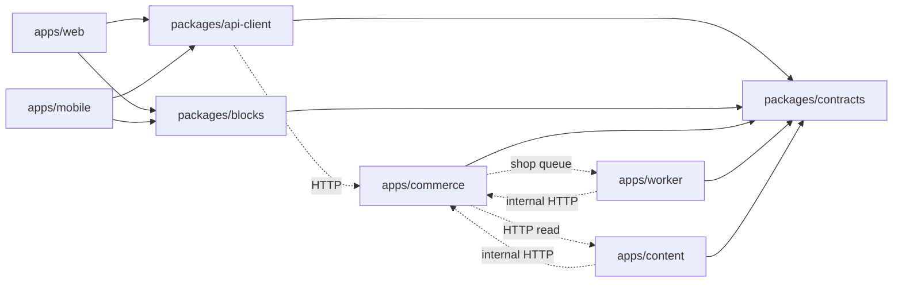
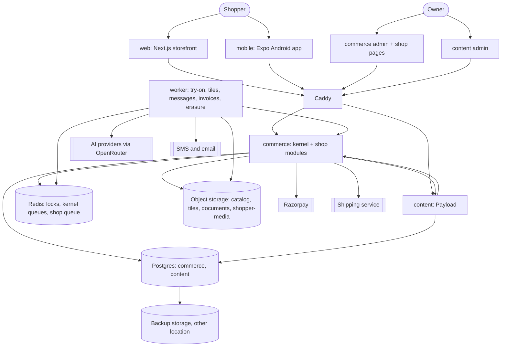
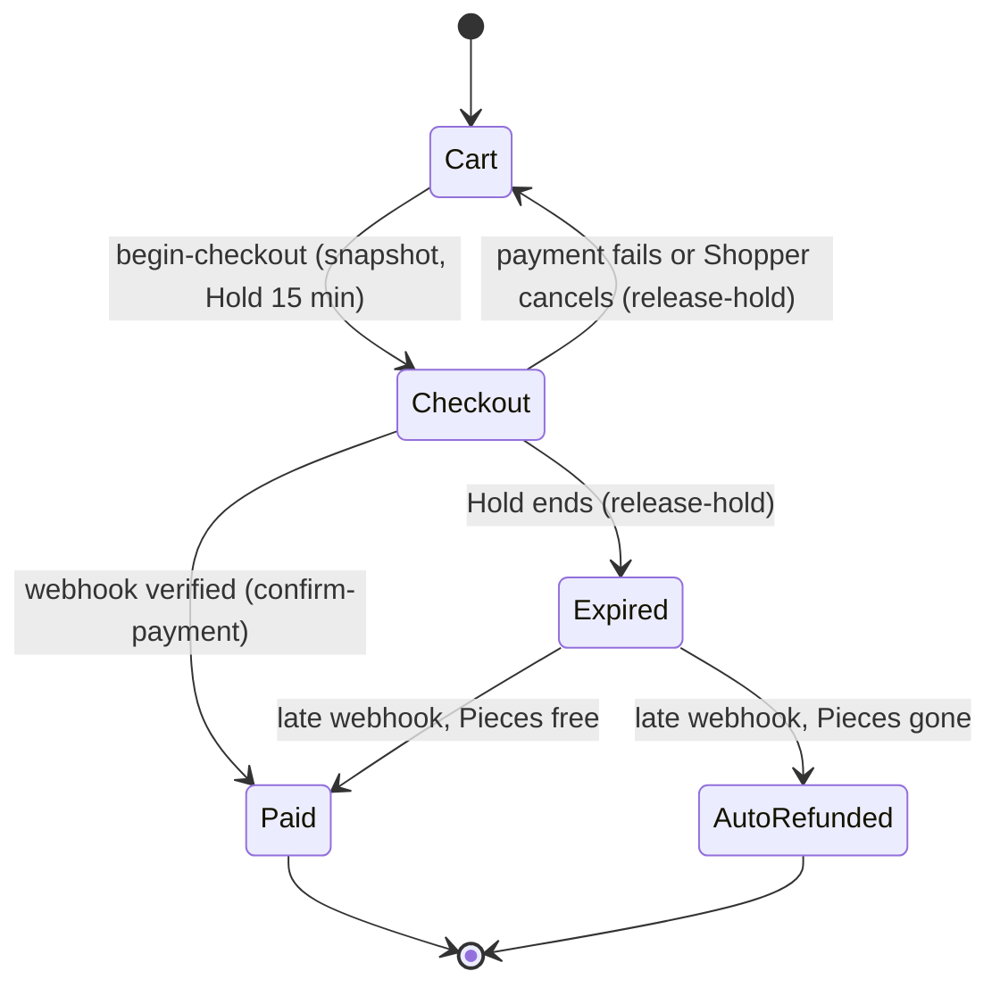
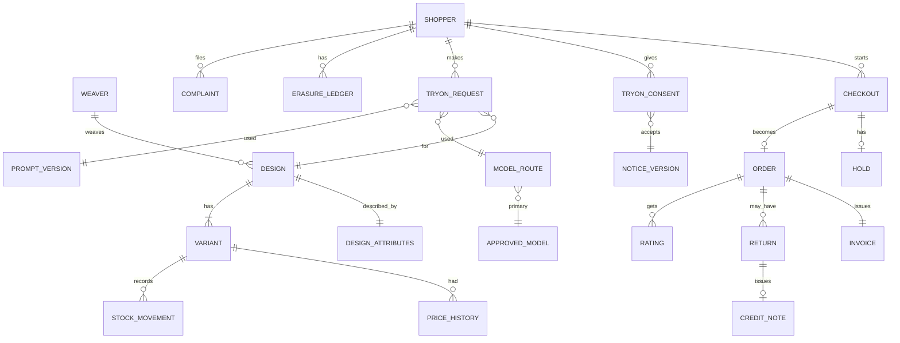

# Architecture Spine — Alar

Items tagged `[ADOPTED]` were decided by the founder. Items tagged `[ASSUMPTION]` were decided here on the fast path and are open to correction. Items tagged `[SPIKE]` are believed true from reading the kernel's source and must be proven in the first build step. Terms follow the PRD Glossary. "The kernel" means the Medusa framework inside `apps/commerce`.

## Design Paradigm

**A modular monolith on a commerce kernel, with ports and adapters at every external edge.**

- **Kernel:** the commerce application. It owns all business state and every state change.
- **Shop modules:** self-contained units added to the kernel. Modules do not call each other; workflows compose them.
- **Ports and adapters:** every outside service is reached through an interface owned by the shop, with one adapter per vendor.
- **Sidecars:** the content application (screens and documents) and the shop worker (slow jobs). Neither owns business state.
- **Clients:** website and Android app. They hold no business rules.

The kernel ships its own routes, admin screens and workflows. They are part of the system, not outside it: AD-21 says which of them may be used.

| Layer | Directory |
| --- | --- |
| Kernel configuration and shop modules | `apps/commerce/src/modules/*`, `apps/commerce/src/workflows/*` |
| Shop API | `apps/commerce/src/api/*` |
| Adapters | `apps/commerce/src/providers/*`, `apps/worker/src/providers/*` |
| Content sidecar | `apps/content` |
| Shop worker | `apps/worker` |
| Clients | `apps/web`, `apps/mobile` |
| Shared contracts | `packages/contracts`, `packages/api-client`, `packages/blocks` |

## Invariants & Rules



Solid arrows are code imports; dotted arrows are runtime calls. No arrow means no dependency is allowed. `packages/*` import no UI framework.

### AD-1 — One writer of business state `[ADOPTED: not microservices]`

- **Binds:** all
- **Prevents:** two units changing an Order, stock, consent or try-on record by different paths.
- **Rule:** only `apps/commerce` writes business state. `apps/worker` and `apps/content` never connect to the commerce database; they change business state only through `/internal/*` on commerce (AD-9).

### AD-2 — Clients reach the backend through one package that returns view models

- **Binds:** `apps/web`, `apps/mobile`, `packages/api-client`
- **Prevents:** screens coupling to the kernel's data shapes; web and mobile reading the same thing differently.
- **Rule:** UI code gets data only from `packages/api-client`. Every function there returns a view model defined in `packages/contracts`; the kernel's SDK and its types never leave that package, and a lint rule fails the build if UI code imports them. Clients never call `apps/content` or a vendor directly, except the payment service's own payment screen. The storefront starter's data layer is replaced by `api-client` before any feature work.

### AD-3 — Data ownership by unit

- **Binds:** all persistence
- **Prevents:** two owners of one entity; joins across units.
- **Rule:** one Postgres server, two databases: `commerce` and `content`. Each application owns and migrates only its own. Content refers to a Design or Weaver only by commerce id; commerce refers to content only by document id and version.

| Entity | Owner |
| --- | --- |
| Design (kernel product), Variant, stock levels, reservations, cart, payment records, Order, fulfilment, refund, discount, Shopper account | kernel |
| Design attributes, Weaver, Hold, Checkout snapshot, Order and Return state, invoice and credit note, price history, stock movement, Try-on consent, Try-on request, Model route, Approved-model list, Prompt version, settings, rating, complaint, erasure ledger, counts, audit event | shop modules in commerce |
| Screens and Blocks, notices, terms, policies, disclosures, message templates, translations, content audit events | content |
| Files | object storage (AD-22), referenced by commerce records |

### AD-4 — Every state change is a workflow; scheduled work starts workflows

- **Binds:** `apps/commerce`
- **Prevents:** business rules scattered across routes, jobs and admin screens; a second scheduler.
- **Rule:** a change to business state runs as a named workflow with compensation steps. Routes, admin actions, kernel subscribers and kernel scheduled jobs only validate input and start a workflow. A shop module's service is called only from a workflow step. The kernel's scheduled jobs are the only scheduler; content has none (AD-12).

### AD-5 — Money is integer paise; one tax and discount calculation

- **Binds:** FR-5, FR-20, FR-37, FR-58
- **Prevents:** floating-point totals; the kernel and shop code computing different totals.
- **Rule:** amounts are integer paise everywhere. A shelf price is tax-inclusive and a multiple of 100 paise. The kernel's tax provider is the shop's own and calls the money functions in `packages/contracts`; nothing else computes tax. A tax code maps to dated value bands (range of per-piece taxable value, after discount and before tax → rate), which expresses both a flat rate and a threshold rule. A discount is applied per piece and rounded down to a whole rupee before tax is derived backwards; any rounding remainder goes into the tax line. Every price change writes a price-history row; the server computes the 30-day lowest price. Clients format amounts and never compute them.

### AD-6 — Stock changes only through named workflows, under one lock

- **Binds:** FR-16, FR-19, FR-22, FR-25, FR-36
- **Prevents:** overselling; a Hold blocking its own Order; a stock count nobody can explain.
- **Rule:** available = stocked − reserved. A Hold is a shop record (Checkout id, expiry) plus kernel reservations tagged with the Hold id. These workflows are the only ones that change stocked or reserved quantities: `begin-checkout`, `confirm-payment`, `release-hold`, `fulfil-order`, `cancel-order`, `adjust-stock`, `restock-return`. Each takes the Redis lock on every inventory item it touches and writes one stock-movement row per change. `confirm-payment` releases the Hold's reservations and completes the cart inside the same lock `[SPIKE]`. A cart has at most one live Hold and cannot change while it has one. A scheduled job runs `release-hold` for expired Holds.

### AD-7 — Payment is confirmed only on the server, from the payment service

- **Binds:** FR-18, FR-19, FR-24, FR-48, NFR-4
- **Prevents:** an Order created on a client's word; two Orders for one Checkout; an underpaid Order.
- **Rule:** the kernel's cart-completion route is blocked for clients (AD-21). The payment service's webhook arrives at the kernel's built-in payment hook route; the shop's Razorpay payment provider verifies the signature and never reports a payment as pending. A subscriber then starts `confirm-payment`, the only workflow that completes a cart into an Order `[SPIKE]`. It is idempotent on the Checkout id, compares the paid amount with the Checkout snapshot, refunds any extra or mismatched capture automatically, and follows FR-19 when the Hold has expired. The client's return from the payment screen only asks for status. A daily job reconciles payments against Orders and alerts on any difference.

### AD-8 — One shop queue beside the kernel's own; jobs are idempotent

- **Binds:** `apps/commerce`, `apps/worker`
- **Prevents:** shop jobs mixed into the kernel's queues; duplicate side effects on retry.
- **Rule:** the kernel's event bus and workflow engine keep their own Redis queues and are not used for shop jobs. Slow shop work runs on one BullMQ queue with the prefix `shop`, at the same BullMQ version the kernel uses. Only commerce workflows enqueue; only `apps/worker` consumes. Job names and payloads are in `packages/contracts`; every job has a deterministic id and is safe to run twice. The Redis that holds queues and locks never evicts keys and persists to disk; caching does not share it.

### AD-9 — Sidecars report through an internal API

- **Binds:** `apps/worker`, `apps/content`, `apps/commerce`
- **Prevents:** a sidecar becoming a second writer.
- **Rule:** the worker and content call `/internal/*` on commerce with a service token. Each such route either starts a workflow or is a read-only lookup (for example the Design and Weaver picker in the content admin). `/internal/*` is not reachable from outside the private network.

### AD-10 — AI providers sit behind one port; guardrails are code

- **Binds:** FR-11, FR-39..FR-43, FR-52, NFR-2, NFR-3
- **Prevents:** provider-specific code in workflows; an admin edit weakening a guardrail.
- **Rule:** the worker reaches AI providers only through `TryOnProvider` (`generate` → result, blocked or failed; `requestErasure`) and `ResultCheck`. Model route, model settings, Prompt version, time limit and cost ceiling are read from the try-on module when the job starts. The fixed safety wording, the no-retention and no-logging flags, and the result check are in worker code and are not data. Each request records provider, model, Prompt version, duration and cost. A Model route is published by one workflow that refuses it if its cost exceeds the ceiling or if it names an AI service absent from the current consent notice (AD-11).

### AD-11 — Consent is tied to a numbered notice that names its recipients

- **Binds:** FR-8, FR-9, FR-15, FR-39, FR-59
- **Prevents:** a notice that is untrue after a route change; two meanings of "current consent".
- **Rule:** a Try-on consent notice in content has an integer version shared by all its translations and a list of AI-service ids. A change of meaning or recipients raises the version; a translation fix does not. On publish, content tells commerce through `/internal/*`; commerce stores the version, service ids and time. A consent record stores Shopper, notice version, language, service ids and time. Consent is current only if its version equals the latest published version. No Try-on job starts without current consent that names the AI service the job will use.

### AD-12 — Server-driven screens are versioned data, composed by commerce

- **Binds:** FR-30..FR-33
- **Prevents:** web and mobile rendering a screen differently; content and clients disagreeing on what a Design Block contains; a second job system for scheduled publishing.
- **Rule:** a screen is a `ScreenV1` document defined in `packages/contracts`. Content stores Blocks with Design and Weaver ids or a rule. Commerce reads them, resolves ids and rules, and embeds a `DesignCard` view model with live price and availability; clients never see content's own shape. `packages/blocks` defines each Block type's properties; each client supplies one component per type. An unknown Block type is skipped. `ScreenV1` changes are additive only. A Block carries data and one action from this fixed list: `open-design`, `open-weaver`, `open-category`, `open-screen`, `open-search`, `open-link` (same site only). It never carries code or expressions. A scheduled screen carries `publish_at`, evaluated when read. Screen layout may be cached for at most 60 seconds; price and availability are never cached that way. Preview uses a signed token and the same route. A client that cannot fetch a screen shows its last copy. The Design page's fixed content is not a Block.

### AD-13 — Regulated values are data with dates

- **Binds:** FR-37, FR-56, FR-59, PRD §8
- **Prevents:** a legal or tax answer changing code.
- **Rule:** tax bands, return period, delivery region, shipping charge rule, Try-on limits and time limit, retention period, Hold length, rate limits and the business time zone are settings with an effective date. Notices and policies are numbered versions in content. Code reads them and never hardcodes them. Day boundaries and the financial year use the business time zone.

### AD-14 — Every admin change is audited, in both admins

- **Binds:** FR-36, FR-46, FR-56, FR-60, NFR-5
- **Prevents:** untraceable changes; an edit to a consent notice leaving no trace.
- **Rule:** commerce records an audit event for every state-changing admin request: actor, time, action, before and after. Content records the same event shape in its own append-only collection. The actor key in both is the admin's email. No route updates or deletes audit events. Every admin read of a Shopper's personal data or photos records an access event, kept one year. The audit module is the shop's own, named `shop-audit`; none of the kernel's paid features (roles, single sign-on, audit) is enabled.

### AD-15 — Three kinds of identity, never mixed

- **Binds:** FR-26, FR-60, AD-9
- **Prevents:** a Shopper token opening the admin; an admin without a second factor.
- **Rule:** Shoppers sign in through the kernel's customer auth with a one-time-code provider. Admin accounts use password plus the kernel's built-in second factor; a middleware refuses any admin request from an account that has not enrolled one. The content admin has the same lockout rule and is reachable only through an extra access gate at the proxy until it has a second factor `[SPIKE]`. Services use service tokens. Each route accepts exactly one kind of identity.

### AD-16 — Portable by construction `[ADOPTED: free tier first, movable later]`

- **Binds:** deployment, NFR-8
- **Prevents:** lock-in to one cloud.
- **Rule:** every unit runs as an ARM64 and x86-64 container started from one compose file. The only outside contracts are Postgres, Redis, the S3 interface, HTTP to vendors and email. No cloud vendor's SDK is used except an S3 client. Configuration comes from environment variables. The same compose file runs locally against the local AWS emulator.

### AD-17 — Recovery is continuous, off the server

- **Binds:** NFR-4, NFR-8
- **Prevents:** a lost server losing paid Orders, invoices or the catalogue.
- **Rule:** Postgres ships its write-ahead log continuously and a full backup nightly, with pgBackRest, to object storage in a different location. A restore script rebuilds the whole system on a clean server, including the secrets that encrypt second factors, and is run before launch and each quarter. Any Order missing after a restore is rebuilt from the payment service's records by the reconciliation job.

### AD-18 — Full saree view is tiles in one web viewer

- **Binds:** FR-6, FR-7
- **Prevents:** two viewers behaving differently.
- **Rule:** the worker cuts each full-length image into a Deep Zoom tile pyramid in the public bucket. Web and mobile show it with the same OpenSeadragon page; on mobile it runs in a web view inside a native screen `[SPIKE: touch behaviour on Android]`.

### AD-19 — One language, one schema source

- **Binds:** all code
- **Prevents:** hand-copied types drifting between server, web and app.
- **Rule:** all units are TypeScript. Every shape that crosses a unit boundary (view model, request, `ScreenV1`, job payload, event, error code, Order and Return state) is a zod schema in `packages/contracts`, and types are inferred from it. No unit redefines such a shape.

### AD-20 — The product name is configuration

- **Binds:** NFR-12
- **Prevents:** a rename touching code or app-store identity.
- **Rule:** the name appears only in settings and content. Package scope is `@shop/*`. Application ids, bucket names, database names and domains in code do not contain it.

### AD-21 — Only allow-listed kernel routes and screens are used

- **Binds:** `apps/commerce`, `packages/api-client`, FR-18, FR-19, FR-36, FR-47, FR-48
- **Prevents:** a built-in route or admin screen changing state without the shop's workflows, stock movements or audit.
- **Rule:** `packages/contracts` holds the list of kernel store and admin routes that may be called. A middleware refuses every other kernel route. Cart completion, and direct edits of stock levels, reservations, payments and refunds, are never on the list; each has a shop route that starts the workflow in AD-6 or AD-7. Built-in admin screens for those actions are hidden and replaced by shop admin pages.

### AD-22 — Files: four buckets, signed links, no photo in transit through logs

- **Binds:** FR-7, FR-10..FR-15, FR-20, FR-27, FR-51, NFR-5, NFR-6
- **Prevents:** a photo leaking by URL or log; erasure missing a copy; a restore bringing a photo back.
- **Rule:** buckets are `catalog` (public, versioned), `tiles` (public), `documents` (private, versioned: invoices, credit notes) and `shopper-media` (private, never versioned, encrypted at rest). A Shopper uploads a photo with a single-use signed upload link issued by commerce, limited by size and type. The worker reads and writes shopper media only through signed links from commerce, valid at most 10 minutes. The provider's output file is stored unchanged, so its provenance data survives. The "AI-generated" label is drawn by clients over the image; one route returns a labelled copy for saving or sharing. No photo, link or image bytes appear in logs, job results or error reports.

### AD-23 — Erasure is one workflow with a ledger

- **Binds:** FR-15, FR-27, FR-28, FR-51, NFR-6
- **Prevents:** a job recreating a result after withdrawal; erasure destroying records the law or the cost view needs.
- **Rule:** `erase-shopper-media` is the only erasure path; withdrawal, the retention job and account deletion call it. It deletes the files, marks the Shopper's Try-on requests erased, removes personal fields from them while keeping model, cost and time, and enqueues one `media.erase-at-provider` job per AI service that received a photo. A result arriving for an erased request is discarded. Every step and each provider's answer is written to the erasure ledger; a failed or unanswered provider request alerts the Owner. A scheduled job alerts if any erasure is older than 24 hours.

### AD-24 — Order and Return states are owned by commerce and named once

- **Binds:** FR-21..FR-25, FR-47
- **Prevents:** each client or agent mapping kernel statuses to states differently.
- **Rule:** the Glossary's Order and Return states are enums in `packages/contracts` with a table of allowed transitions. One workflow performs each transition. The shipping adapter holds the one table that maps the shipping service's events to transitions. The server stores and returns the state; clients never derive it.

### AD-25 — Invoices and credit notes are immutable documents with their own numbers

- **Binds:** FR-20, FR-24
- **Prevents:** an invoice that changes after issue; duplicate or gapped numbers.
- **Rule:** the invoice module creates an invoice from the Checkout snapshot when an Order is created, and a credit note when a refund is made. Records are never edited. Numbers are gapless: each comes from a counter row per document type and financial year, locked and incremented in the same transaction that creates the record. The number is also written to the Checkout's recovery file (AD-30). The worker renders the file with `invoice.render` into the `documents` bucket.

### AD-26 — All messages are jobs, sent by the worker

- **Binds:** FR-26, FR-54, NFR-9
- **Prevents:** two senders; text in code.
- **Rule:** every message to a Shopper or the Owner is a `message.send` job with template key, language, variables and channel; its id is the event id plus the channel. The kernel's notification provider only enqueues that job. The worker fetches the template from content through commerce, and sends through an SMS or email adapter. One-time codes follow the same path and never appear in logs or job results.

### AD-27 — Released apps keep working

- **Binds:** `apps/mobile`, `packages/api-client`, FR-32, FR-55
- **Prevents:** a server change breaking an app already on phones.
- **Rule:** shop routes change additively only; clients ignore fields they do not know. Every request carries `X-Client` with platform and version; a middleware returns the error `client.update_required` when the version is below the minimum in settings. Continuous integration replays recorded server responses against the schema of every released app version.

### AD-28 — Design attributes and catalogue reads have one home

- **Binds:** FR-1..FR-5, FR-34, FR-38, FR-57
- **Prevents:** attributes stored three ways; filters and availability computed by clients.
- **Rule:** a Design's attributes (fibre, weave, zari, colour from a fixed list, occasion tags, place woven, dimensions, blouse piece, care, origin, tax code, stitched, claims with evidence) are typed fields of the `design-attributes` module, linked to the kernel product, with their schema in `packages/contracts`. The kernel's free-form metadata is not used for them. `/store/shop/designs` is the only catalogue read: it returns view models, filter counts, search results and server-computed availability. A Design is published only by the `publish-design` workflow, which enforces FR-34 and FR-38. Translated Design and Weaver text is stored with the Design and Weaver in commerce; interface text lives in translation files in the clients; documents and message templates live in content.

### AD-29 — Counts are the shop's own

- **Binds:** NFR-16, PRD §9
- **Prevents:** an advertising or analytics SDK collecting Shopper data.
- **Rule:** the counts module in commerce records the events named in NFR-16 without a Shopper identity. Clients report them through `api-client`. No third-party analytics or advertising SDK is added to web or mobile.

### AD-30 — Every Checkout leaves a recovery file off the server

- **Binds:** NFR-4, NFR-8, AD-17, AD-25
- **Prevents:** a restore losing an Order's contents or reusing an invoice number.
- **Rule:** `begin-checkout` writes the Checkout snapshot (items, quantities, prices, tax, address, Shopper id) as a file in the `documents` bucket, keyed by Checkout id; `confirm-payment` adds the Order id and invoice number to it. After a restore, the reconciliation job rebuilds any Order the payment service shows as paid from its recovery file, with its original numbers, and sets each counter to the highest number issued before the shop accepts Orders again.

### AD-31 — Named homes for records the stories exposed

- **Binds:** FR-9, FR-25, FR-26, FR-27, FR-48
- **Prevents:** three agents inventing three homes.
- **Rule:** acceptances of terms, policies and the Try-on consent notice are all records of the `consent` module (document type, version, language, time). Payment disputes are records of the `checkout` module, linked to the Order. Inspection photos are files in the `documents` bucket, linked to the Return. An Order is `Refunded` only when every item in it has been refunded; a partial refund shows on the Return and the Order keeps its state. An account cannot be deleted while it has an Order that is neither Delivered past its return period, nor Cancelled, nor Refunded; Shopper photos and Try-on results are erased at once in any case.

### AD-32 — Checks and costs for AI output

- **Binds:** FR-45, FR-52, AD-10, AD-23
- **Prevents:** an unchecked result being shown; costs in mixed currencies; erasure silently unsupported.
- **Rule:** `ResultCheck` is a vision-capable model on the Approved-model list, marked as a check model, reached through the same provider port; if the check fails to run, the result is not shown. Provider prices are converted to paise with an exchange-rate setting when recorded. A provider that offers no erasure call is recorded in the erasure ledger as "not supported; relies on the provider's stated retention" and the Owner is alerted once per provider, not per request.

## Consistency Conventions

| Concern | Convention |
| --- | --- |
| Naming | Files and directories kebab-case; types PascalCase; tables and columns snake_case; workflows verb-noun (`begin-checkout`); events `noun.past-verb` (`order.paid`); jobs `noun.verb` (`tryon.generate`). |
| Ids and time | The kernel's prefixed ids. UTC ISO 8601 in storage and APIs; clients display the business time zone. |
| Errors | Every API error is `{ code, message, details? }` with a stable `code` from `packages/contracts`. Clients branch on `code`. |
| Idempotency | Every client request that changes state sends an `Idempotency-Key`. Webhooks and jobs are idempotent on the sender's id. |
| Rate limits | One-time-code sends, upload links, Try-on requests and sign-in attempts are limited in commerce middleware, with limits from settings. |
| Working days | Monday to Saturday in the business time zone, excluding the holidays listed in settings. |
| Test profiles `[ASSUMPTION]` | Speed is measured on an Android phone with 4 GB of memory on a throttled 4G profile (10 Mbit/s down, 100 ms delay). Launch load is 50 Shoppers browsing at once, 5 Checkouts a minute and 2 Try-on jobs at once. Alert thresholds: errors above 2% of requests over 5 minutes; payment or Try-on failures above 20% over 15 minutes. All are settings. |
| Payments in the app | The payment service's own hosted payment page, opened from the app; no push service at launch, so a ready Try-on result is found by polling. |
| App-store review | One reviewer account with a fixed sign-in code can be switched on in settings for a single number, and is off otherwise. |
| Logging and alerts | Structured JSON with a request id carried from client to commerce to worker to vendor. No personal data, photos, links, tokens, codes or card data. Health routes on every unit; alerts for the cases in NFR-9 go out as `message.send` jobs and through an outside uptime check. |
| Config and secrets | Environment variables only, checked at start against a zod schema. Secrets never in the repository; the restore script documents every secret. |
| Vendors | Used only through an adapter in a `providers/` directory, with contract tests against the vendor's test mode (NFR-11). |
| Text and languages | No Shopper-facing text in code; all of it comes from content or a translation file. Each request carries the Shopper's language. |
| Speed | Product photos are served in sizes fitted to the device from the `catalog` bucket; pages do not wait on Try-on, counts or messages (NFR-1). |
| Accessibility | Every interactive element has a label; layouts hold at the largest system font size (NFR-15). |
| Routine work | Anything the Owner does weekly is an admin page, not a command (NFR-10). Breach handling is a written runbook in `docs/` (NFR-7). |
| Testing | Each workflow has tests for success, each failure and compensation. One end-to-end test buys, ships and returns a saree. All must pass before a deploy. |
| Migrations | Each application migrates only its own database; a deploy runs migrations before starting new containers. |

## Stack

Versions read from the package registry and the starter repository on 2026-11-27. Server products marked `[SPIKE]` have not been run together.

| Name | Version |
| --- | --- |
| Node.js | 24 LTS (24.22.3 or later) |
| TypeScript | 6.0.x |
| pnpm workspaces + Turborepo | as pinned by the Medusa DTC starter |
| Medusa (`@medusajs/medusa`) | 2.23.1 |
| Medusa DTC starter (backend + storefront) | current `main`; storefront on Next.js 16.3.8, React 19.0.5 |
| Payload (`payload`, `@payloadcms/next`, `@payloadcms/db-postgres`, `@payloadcms/storage-s3`) | 3.94.2, on Next.js 16.4.6, React 19.3.1 |
| Expo | 58.1.0 |
| React Native | 0.88.1 (React 19.3.0) |
| expo-router | 58.0.33 |
| react-native-webview | 14.0.1 |
| PostgreSQL | 17 |
| Redis | 8.x `[SPIKE]` |
| BullMQ | 6.7.6 (the version the kernel bundles) |
| zod | 4.6.7 |
| sharp (libvips) | 0.35.5 |
| OpenSeadragon | 6.1.1 |
| Razorpay Node SDK | 2.9.8 |
| Playwright (`@playwright/test`), end-to-end tests | 1.65.1 |
| PDFKit (`pdfkit`), invoice files | 0.21.0 |
| k6, load tests | current stable |
| pgBackRest | current stable |
| Caddy | 2 |
| Docker Compose | v2 |
| Floci (local AWS emulator) | pinned to a release tag at setup |

## Structural Seed

### Containers



The kernel runs its subscribers and scheduled jobs only in worker mode. On the first server, commerce runs in the kernel's shared mode (one container does both); an environment variable splits it into a server container and a worker container later.

### Checkout and Hold



### Try-on

```mermaid
sequenceDiagram
  participant C as Client
  participant K as commerce
  participant S as Object storage
  participant Q as Shop queue
  participant W as worker
  participant P as AI provider
  C->>K: ask for upload link
  K-->>C: single-use signed link
  C->>S: upload Shopper photo
  C->>K: request Try-on (Design, photo)
  K->>K: check consent, age, limit, daily cap, off switch
  K->>Q: tryon.generate
  K-->>C: accepted, request id
  W->>Q: take job
  W->>K: read Model route, Prompt version, signed links
  W->>P: generate (primary)
  alt fails or time limit passes
    W->>P: generate (fallback, once)
  end
  W->>W: check result
  W->>S: store provider file unchanged
  W->>K: report result, blocked or failed, with cost
  C->>K: poll status
  K-->>C: signed link; client draws the label
```

### Core entities



### Repository

Created from the Medusa DTC starter: its `apps/backend` becomes `apps/commerce`, its `apps/storefront` becomes `apps/web`. The starter's card-payment checkout is replaced by the Razorpay provider.

```text
/
  apps/
    commerce/
      src/modules/    # design-attributes, weaver, hold, checkout, order-state, invoice, price-history,
                      # stock-ledger, tryon, consent, settings, rating, complaint, erasure, counts, shop-audit
      src/workflows/  # begin-checkout, confirm-payment, release-hold, fulfil-order, cancel-order, adjust-stock,
                      # restock-return, publish-design, publish-model-route, erase-shopper-media, ...
      src/providers/  # razorpay (payment), shipping (fulfilment), one-time-code (auth), tax, notification
      src/api/        # store/shop/*, admin/shop/*, internal/*, webhooks/* (shipping), middlewares
      src/subscribers/# payment confirmed, order events
      src/jobs/       # expired Holds, retention, reconciliation, erasure deadline
      src/admin/      # shop admin pages
    content/          # Payload: screens, blocks, notices, policies, templates, translations, audit
    worker/
      src/jobs/       # tryon.generate, tiles.build, message.send, invoice.render, media.erase-at-provider
      src/providers/  # TryOnProvider adapters (openrouter first), ResultCheck, sms, email
    web/              # Next.js storefront
    mobile/           # Expo app
  packages/
    contracts/        # zod schemas, view models, error codes, states, money functions, route allow-list, job names
    api-client/       # the only way clients talk to the backend
    blocks/           # Block types and properties (no UI code)
  infra/              # compose files, Caddy config, backup and restore scripts
  docs/
```

### Deployment and environments

| Environment | Where | Notes |
| --- | --- | --- |
| Local | Developer machine, compose | Local AWS emulator for object storage; vendor test modes |
| Staging | The Oracle Cloud free ARM server `[ADOPTED]` | Vendor test modes; restore rehearsals |
| Production | Decided at the size gate below | Vendor live modes; backups in another location |

Oracle's free allowance is reported as 2 CPUs and 12 GB of memory for the whole account, so staging and production cannot both run on it all the time.

**Size gate, in the first build step:** run every container on the free server under a simulated launch load. If it holds, production takes the free server at launch and staging runs on demand; if it does not, production starts on a paid server. Either way AD-16 and AD-17 apply.

Images are built in continuous integration for ARM64 and x86-64 and rolled out by replacing containers.

## Capability → Architecture Map

| Capability | Lives in | Governed by |
| --- | --- | --- |
| Catalogue, search, Design page, Weavers (FR-1..FR-5, FR-57) | `design-attributes`, `weaver`, `price-history`; `/store/shop/designs` | AD-2, AD-5, AD-28 |
| Full saree view (FR-6, FR-7) | worker `tiles.build`; viewer page | AD-18, AD-22 |
| Try-on consent, age, photo (FR-8..FR-10) | `consent`, `tryon`; upload route | AD-11, AD-22 |
| Try-on generation, check, label, report, limits (FR-11..FR-14, FR-52) | `tryon`; worker `tryon.generate` | AD-8, AD-10, AD-22 |
| Erasure and retention (FR-15, FR-27, FR-51, NFR-6) | `erasure`; worker `media.erase-at-provider` | AD-23 |
| Cart, delivery check, checkout, no overselling (FR-16..FR-19) | kernel cart; `hold`, `checkout`; razorpay provider | AD-6, AD-7, AD-21 |
| Invoice, refund, credit note (FR-20, FR-24, FR-48) | `invoice`; refund workflow | AD-5, AD-7, AD-25 |
| Order tracking, cancel, Return, inspection, rating (FR-21..FR-25, FR-53) | `order-state`, `rating`; shipping provider | AD-6, AD-24 |
| Sign-in, privacy requests, disclosures, messages (FR-26, FR-28, FR-29, FR-54) | one-time-code provider; `complaint`; content; worker `message.send` | AD-15, AD-26, AD-14 |
| Server-driven screens, minimum version (FR-30..FR-33, FR-55) | content; `/store/shop/screens`; `packages/blocks` | AD-12, AD-27 |
| Admin: Designs, Variants, stock, tax, claims, settings, discounts, notices (FR-34..FR-38, FR-56, FR-58, FR-59) | shop admin pages; `publish-design`; `settings`; content admin | AD-5, AD-6, AD-13, AD-21, AD-28 |
| Admin: AI controls (FR-39..FR-46) | `tryon`; `publish-model-route`; shop admin pages | AD-10, AD-11, AD-14 |
| Admin: Orders, Shoppers, sign-in (FR-47..FR-49, FR-60) | shop admin pages; `shop-audit` | AD-14, AD-15, AD-21 |
| Speed, Try-on time and cost (NFR-1..NFR-3) | conventions; `tryon` settings | AD-10, Conventions |
| Exact payments, recovery (NFR-4, NFR-8) | reconciliation job; `infra/` | AD-7, AD-17 |
| Security, breach response (NFR-5, NFR-7) | buckets, access events, runbook | AD-14, AD-22, Conventions |
| Monitoring, one operator, tested integrations (NFR-9..NFR-11) | health routes, alerts, admin pages, contract tests | AD-26, Conventions |
| Renameable, honest design, languages, accessibility, counts (NFR-12..NFR-16) | settings, content, clients, `counts` | AD-20, AD-29, Conventions |

## Deferred

| Decision | Why it can wait |
| --- | --- |
| Which try-on model and settings | Decided by the launch gate test; AD-10 makes it data. |
| Fine-tuned or self-hosted model | A new adapter under AD-10. |
| iOS app | Same Expo codebase; needs store setup and review. |
| Cash on delivery | A payment option plus reconciliation; AD-7 and AD-24 already allow it. |
| Staff roles (FR-50) | AD-14 already records the actor; decide to buy the kernel's roles or build them when a second person joins. |
| One sign-in for both admins `[ASSUMPTION]` | The Owner uses two logins at launch, keyed by the same email. |
| Search engine `[ASSUMPTION]` | Postgres full-text search inside `/store/shop/designs` serves about 100 Designs. |
| SMS, email, error-tracking and uptime vendors | Each sits behind an adapter or is configuration. |
| CDN | The public buckets are CDN-ready; add one when traffic needs it. |
| A second Redis for caching | The kernel's in-memory cache serves one server; add a separate evicting Redis when commerce is split. |
| Payload 4 | In beta; stay on 3.x until it is stable. |

## First build step: what the spike must prove

1. `confirm-payment` can release a Hold and complete the cart inside one lock without double-reserving (AD-6, AD-7).
2. Blocking the kernel's cart-completion route for clients leaves the server-side path working (AD-21).
3. The kernel, Payload, the worker, Postgres 17 and Redis 8 run together on Node 24 on an ARM64 server (Stack).
4. The size gate (Deployment).
5. A sample `ScreenV1` document renders in a minimal Expo app on a real mid-range Android phone (AD-12).
6. OpenSeadragon, with a sample tile set, behaves under touch inside that app's web view (AD-18).
8. A blurred, translucent navigation bar over scrolling images holds a smooth frame rate on that phone; the result informs the design system and confirms or reopens the choice of React Native.
7. The content admin can be given a second factor, or stays behind the proxy gate (AD-15).
